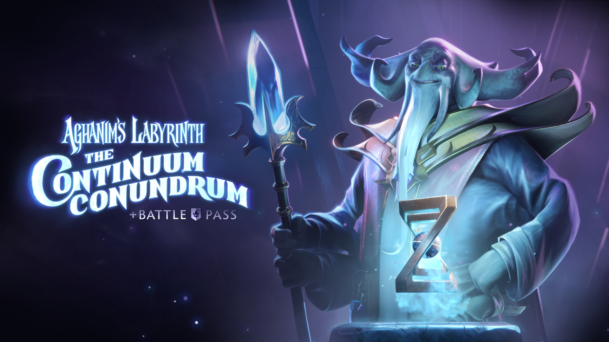
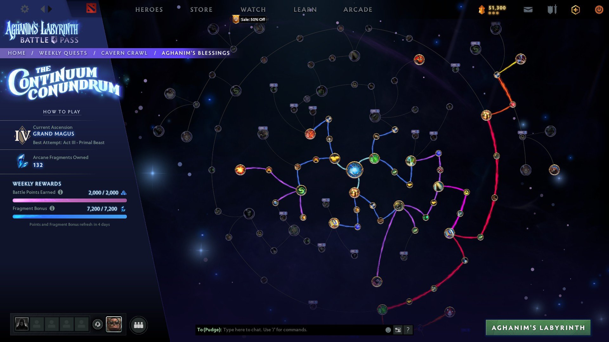

# Дары Аганима — Интерактивная карта-созвездие (Dota 2: Колдовской континуум)

Интерактивная веб-реконструкция дерева **«Дары Аганима»** (*Aghanim's Blessings*) из зимнего ивента Dota 2 **«Лабиринт Аганима: Колдовской континуум»** (*Aghanim's Labyrinth: The Continuum Conundrum*, декабрь 2021 — февраль 2022) с полным собранием ироничных комментариев Аганима на русском языке и возможностью сверки с оригиналом Valve (EN).

👉 **[Открыть интерактивную карту](https://eniggman.github.io/dota2-continuum-conundrum-blessings/)**

---

### Оригинальное древо в клиенте Dota 2 (Зима 2021–2022)

---

## Что внутри

* **Все 109 узлов созвездия (150 800 волшебных фрагментов):**
  * 1 стартовый дар (`+1 к зарядам бутыли`, 100 фр.)
  * 25 крупных даров (16 уникальных типов, 52 900 фр.)
  * 68 малых даров (25 уникальных типов, 67 800 фр.)
  * 15 героев-ветеранов из первого «Лабиринта Аганима» 2020 года (`Возвращение ветерана`, 30 000 фр.)
* **Все 42 комментария Аганима:** для стартового дара использована дословная русская локализация из клиента Dota 2, остальные переведены с полных оригинальных реплик Valve с сохранением интонации Аганима — в любой карточке можно нажать **«Оригинал (EN)»**.
* **Атмосфера оригинального клиента:** изогнутые неоновые дуги созвездия (бирюзовый → синий → фиолетовый → алый → золотой), официальные иконки предметов и портреты героев Dota 2, панель Боевого пропуска с рангом вознесения.
* **Планировщик маршрута:** кнопка **«Проложить путь»** подсвечивает кратчайший маршрут до любого дальнего узла и считает точную стоимость в волшебных фрагментах.
* **Два режима просмотра:** интерактивная карта-созвездие (зум, панорамирование, поиск, фильтры по веткам) и **«Книга реплик»** для чтения всех комментариев подряд.

## English Summary

An interactive single-file constellation map reconstructing the **Aghanim's Blessings** skill tree from Dota 2's winter 2021–2022 event **Aghanim's Labyrinth: The Continuum Conundrum** (all **109 nodes**, **150,800 Arcane Fragments**, **15 Veteran Heroes**, and all **42 Aghanim flavor commentaries** in Russian with an instant **Original EN** toggle).

**Live Demo:** https://eniggman.github.io/dota2-continuum-conundrum-blessings/

## Источники данных и дисклеймер

* Структура узлов, стоимость в волшебных фрагментах и оригинальные английские реплики Аганима: [Dota 2 Wiki](https://dota2.fandom.com/wiki/Aghanim%27s_Labyrinth:_The_Continuum_Conundrum), [Liquipedia](https://liquipedia.net/dota2/Aghanim%27s_Labyrinth_Battle_Pass) и официальная страница [Dota 2](https://www.dota2.com/labyrinth?l=russian).
* Проект создан как фанатский архив. Dota 2 и все связанные графические материалы принадлежат Valve Corporation.
